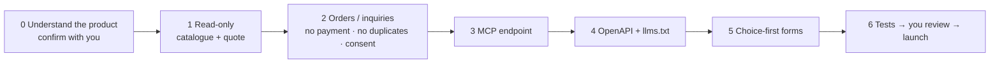

# agent-ready

**English** · [中文](README.zh-CN.md)

**Turn a website that sells services or goods into one that people and AI assistants can both order from.**

   

More and more people will ask an AI assistant to look up prices, compare and book for them. This skill packages one way to get ready for that **without changing prices or touching payments**: agents can discover the product, understand the price and submit an order for the customer, and a person still confirms and takes the money.

Proven live on [Shuttlely.ca](https://shuttlely.ca): a route catalogue across four cities, instant quotes, agent orders and inquiries, and an MCP endpoint.

---

## What your product gets

| Endpoint | What it does | Who can call it | Risk |
|---|---|---|---|
| `GET /api/agent/catalog` | What can be bought: ids, names, from-prices, detail pages | anyone, any web page | none (read-only) |
| `POST /api/agent/quote` | A request in, a price range and deposit out, **identical to the website's price** | anyone, any web page | none (read-only) |
| `POST /api/agent/orders` | Places an order for the customer and returns an order number; **no payment** | servers only | low: a person confirms before any money |
| `POST /api/agent/inquiries` | Written-quote requests for what cannot be priced instantly | servers only | low: goes only to your inbox |
| `POST /api/mcp` | The same four actions over MCP, ready for any AI assistant | servers only | as above |
| `/openapi.json`, `/llms.txt` | The manual for AI readers | anyone | none |

Website forms also become **choice-first**: city, item, date and party size are buttons; typing is needed only for "custom".

---

## How it works



**Step 0 always stops to ask you** what the product sells, how prices are computed and which legal or business lines it must not cross. Code starts only after you confirm, so nothing is copied blindly from another project.

---

## Eight iron rules

1. **One price**: the agent quote calls the website's own pricing code, with a test proving they match.
2. **Agent orders take no payment**: an order number only; a person confirms and then sends a payment link. The server re-prices and trusts no price in the request.
3. **Three gates on every write**: a request id (resending never books twice, different content is refused), customer consent and the customer's own email, plus limits per IP, per recipient email and site-wide.
4. **Never a way to email strangers**: nothing the caller typed into an email to the customer may carry a link or an email address.
5. **Writes are server-side only**: requests from web pages on other sites are refused.
6. **Choices first**: forms and API fields use options; text only for "custom".
7. **No single-platform bet**: REST, OpenAPI, MCP and llms.txt only.
8. **You review before launch**: afterwards only quotes and the handshake are called live, never a real order.

---

## Install

```bash
git clone https://github.com/howardchenghuang-dotcom/agent-ready.git ~/.claude/skills/agent-ready
```

## Use

In any project, tell Claude Code:

```text
/agent-ready
```

or simply "make this project agent-ready". One step at a time:

```text
/agent-ready step 1 only (read-only endpoints)
```

## How other people's AI connects to your product afterwards

```bash
claude mcp add --transport http your-product https://your-domain.com/api/mcp
```

Other MCP-capable tools take `https://your-domain.com/api/mcp` in their settings.

---

## What's in the repo

```text
agent-ready/
├── LICENSE                               MIT
├── SKILL.md                              Workflow, iron rules, framework table (what Claude reads)
├── SKILL.zh-CN.md                        Chinese version, for people
├── references/
│   ├── playbook.md / .zh-CN.md           Full rules; section 3 can be pasted into a project's rules file
│   └── shuttlely-reference.md / .zh-CN.md  Reference implementation: files, techniques, security review
└── templates/
    ├── mcp-handler.ts                    MCP handler (handshake, tool list, calls)
    └── agent-http.ts                     CORS and Origin checks, rate limits, duplicates, name check
```

Supports Next.js on Vercel (the templates' default), Cloudflare Workers and Python FastAPI; `SKILL.md` lists what changes per framework.

## Known limits

- Rate-limit counters live in server memory. On multi-instance platforms they are only a backstop; with real traffic move them to a shared store or the platform firewall.
- So far run end to end on one project (Shuttlely).

## Changelog

- **1.0.0** (2026-10-28): first public release, built from the Shuttlely.ca implementation including its security-review fixes (no emailing strangers, server-side-only writes, safe MCP tool lookup, 409 for a reused request id with different content). English documents with Chinese versions alongside.

## License

[MIT](LICENSE). Use it, change it, ship it.
