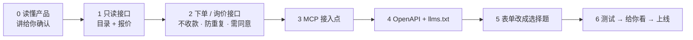

# agent-ready

[English](README.md) · **中文**

**把一个卖服务或商品的网站，改造成「人能下单，AI 助手也能下单」。**

   

越来越多的人会让 AI 助手替自己查价、比价、下单。这个技能把一套做法固定下来：在**不改变价格、不碰收款**的前提下，让 AI 能发现你的产品、看懂价格、替用户提交订单，最后由人确认、由人收钱。

已在 [Shuttlely.ca](https://shuttlely.ca) 上线验证：包括 4 个城市的线路目录、即时报价、AI 下单和询价，以及 MCP 接入点。

---

## 做完之后，你的产品会多出这些

| 地址 | 做什么 | 谁能调用 | 有没有风险 |
|---|---|---|---|
| `GET /api/agent/catalog` | 列出能卖的东西：代号、名称、起步价、详情页 | 任何人、任何网页 | 无（只读） |
| `POST /api/agent/quote` | 输入需求，返回价格区间和定金；价格和网页**完全一致** | 任何人、任何网页 | 无（只读） |
| `POST /api/agent/orders` | 替用户下单，返回订单号；**不收款** | 只接受服务器调用 | 低：人工确认后才收钱 |
| `POST /api/agent/inquiries` | 不能即时报价的，发书面询价 | 只接受服务器调用 | 低：只发到你的收件箱 |
| `POST /api/mcp` | 上面四件事的 MCP 版，AI 助手连上就能用 | 只接受服务器调用 | 同上 |
| `/openapi.json`、`/llms.txt` | 给 AI 读的说明书 | 任何人 | 无 |

另外，网页上的表单会改成**选择题优先**：城市、项目、日期、人数都用按钮选，只有「定制」才需要打字。

---

## 它怎么干活



**第 0 步一定先停下来问你**：这个产品卖什么、价格怎么算、有哪些法律或业务红线。你确认之后才写代码。每个产品都不一样，不会照搬别的项目。

---

## 八条铁律

1. **一套价格**：接口报价调用网站本身的计价代码，有测试保证和网页报价一模一样。
2. **AI 下单不收款**：只生成订单号，人工确认后再发付款链接；服务器自己重新算价，不信请求里的价格。
3. **写操作三道门**：请求编号（重发不会重复下单，换内容会被拒绝）、用户同意、用户本人的邮箱；再加上按 IP、收件邮箱、全站三层限流。
4. **不能被拿来替别人发信**：会发给客户的邮件里，客户填的姓名等内容不许带网址或邮箱。
5. **写操作只给服务器调用**：其他网站的网页发来的请求一律拒绝。
6. **选择题优先**：表单和接口字段都用选项，只有「定制」才用文字。
7. **不押注单一平台**：只用 REST、OpenAPI、MCP、llms.txt 这些通用格式。
8. **先给你看再上线**：上线后只调报价和握手，不发真实订单。

---

## 安装

```bash
git clone https://github.com/howardchenghuang-dotcom/agent-ready.git ~/.claude/skills/agent-ready
```

## 使用

在任意项目里，对 Claude Code 说：

```text
/agent-ready
```

或者直接说「给这个项目做 Agent 接入」。如果想分步做：

```text
/agent-ready 只做第 1 步（只读接口）
```

## 做完后，别人的 AI 怎么接入你的产品

```bash
claude mcp add --transport http your-product https://your-domain.com/api/mcp
```

支持 MCP 的其他软件，在设置里填 `https://your-domain.com/api/mcp` 即可。

---

## 仓库里有什么

```text
agent-ready/
├── LICENSE                               MIT 许可证
├── SKILL.md                              流程、铁律、换框架对照表（英文，Claude 读这个）
├── SKILL.zh-CN.md                        中文版，给人看
├── references/
│   ├── playbook.md / .zh-CN.md           完整规则；第 3 部分可以直接贴进项目的规则文件
│   └── shuttlely-reference.md / .zh-CN.md  参考实现：文件清单、关键做法、安全复查记录
└── templates/
    ├── mcp-handler.ts                    MCP 处理函数（握手、列工具、调用）
    └── agent-http.ts                     跨域与来源检查、限流、防重复、姓名检查
```

支持 Next.js + Vercel（模板默认）、Cloudflare Worker、Python FastAPI。换框架时要改哪几处，在 `SKILL.md` 里有对照表。

## 已知限制

- 限流计数记在服务器内存里。多实例的平台上只能算兜底；流量大了要换成共享存储或平台防火墙。
- 目前只在 Shuttlely 一个项目上完整跑过。

## 更新记录

- **1.0.0**（2026-10-28）：第一个公开版本。内容来自 Shuttlely.ca 的实现，包含安全复查后的修复：防止被拿来发信、写接口只给服务器调用、MCP 工具名检查、请求编号配不同内容会被拒绝。文档以英文为主，配中文版。

## 许可证

[MIT](LICENSE)：可以随意使用、修改、商用。
